  

# Awesome Cloud Collaboration Platform ☁️

  
  
  
  
  
  
  

> **A curated directory of top Cloud Collaboration Platforms, enterprise SaaS productivity suites, and sovereign self-hosted open-source workspace tools.** 🌟 *Star this repository to bookmark and support future updates!* 🌟

---

## 📌 Overview & Context

Modern cloud collaboration platforms form the backbone of distributed engineering teams, digital workspaces, and high-performance enterprises. These suites bring together **team chat**, **real-time document co-editing**, **relational databases**, **agile project management**, and **secure file synchronization**.

This directory tracks:
- **Commercial SaaS Platforms**: Industry leaders providing turnkey managed collaboration suites, deep third-party ecosystems, and native AI assistants.
- **Sovereign Open-Source Projects**: Self-hostable, privacy-first software solutions empowering organizations to maintain 100% data ownership, compliance, and custom infrastructure.

---

## 📑 Table of Contents

- [📈 Sector Overview & Market Dynamics](#-sector-overview--market-dynamics)
- [🏢 SaaS/Hosted Platforms](#-saashosted-platforms)
- [💻 Open-Source GitHub Projects](#-open-source-github-projects)
- [🤝 How to Contribute](#-how-to-contribute)
- [💖 Support & Community](#-support--community)
- [📊 Star History](#-star-history)
- [⚖️ Disclaimer](#-disclaimer)

---

## 📈 Sector Overview & Market Dynamics

The global cloud collaboration market is estimated at **$60.5B to $73.6B in 2026**, expanding at a robust compound annual growth rate (CAGR) of **13%–16%**.
The industry displays a distinct **dual-market dynamic**:
1. **Moderately Fragmented Specialty Layer**: Workflow tools, niche whiteboard canvases, modular databases, and asynchronous task tools (e.g., Asana, Notion, Monday.com, Box) compete across differentiated features.
2. **Highly Concentrated Core Platform Layer**: Enterprise communications, identity management, and unified office suites operate as a **concentrated, winner-take-all** ecosystem where tech giants (primarily Microsoft and Google) capture the lion's share of enterprise IT procurement through aggressive software bundling and native AI copilots.

---

## 🏢 SaaS/Hosted Platforms

The table below catalogs premier commercial collaboration suites, sorted in **descending order by company scale** (Market Capitalization / Private Valuation / Annual Revenue).

| Platform | Starting Tier Price | Free Tier Limits / Free Trial | Company Scale (Market Cap / Valuation / Revenue) | Best For & Core Features |
| :--- | :--- | :--- | :--- | :--- |
| **[Google Workspace](https://workspace.google.com/)** | $7.00/user/month (Business Starter, billed annually) | 14-day free trial (up to 10 users, credit card required; ends immediately if 11th user is added) | ~$3.8T Market Cap (~$350B+ annual revenue via Alphabet) | Teams wanting simple, browser-first collaboration with strong real-time co-editing across Docs/Sheets/Slides, Gmail, and Google Meet. |
| **[Microsoft 365](https://www.microsoft.com/microsoft-365)** | $6.00/user/month (Business Basic, billed annually) | Permanent free web apps (Word, Excel, PowerPoint on browser with 5 GB OneDrive storage); or 30-day free trial of premium desktop apps (up to 25 seats for Business Standard, credit card required) | ~$3.6T Market Cap (~$245B+ annual revenue) | Organizations deeply invested in Microsoft ecosystem wanting unified identity, compliance, and collaboration. |
| **[Slack](https://slack.com/)** | $8.75/user/month (Pro, billed annually) | Permanent free plan with 90-day searchable message & file history limit (older data hidden/archived; permanently deleted after 1 year), 10 app integrations, 1-on-1 audio/video huddles, and 5 GB storage | ~$27.7B Acquisition / ~$300B+ Market Cap (~$38B annual revenue via Salesforce) | Teams wanting a flexible collaboration hub with broad third-party app support. |
| **[Atlassian Cloud](https://www.atlassian.com/)** | $7.15/user/month (Jira Standard, billed annually) | Permanent free plan: Jira & Confluence free for up to 10 users per site with 2 GB pooled file storage; Trello free for up to 10 collaborators per workspace (max 10 open boards, 10 MB per attachment) | ~$55B Market Cap (~$5.2B annual revenue) | Software teams wanting integrated issue tracking, documentation, and code collaboration. |
| **[Notion](https://www.notion.com/)** | $10.00/user/month (Plus, billed annually) | Permanent free plan: Unlimited blocks for solo users, 1,000 lifetime blocks when adding 2+ members, 10 guest collaborators, 5 MB file upload limit, and 7-day page version history | ~$11B Private Valuation (~$600M+ ARR) | Teams wanting flexible, database-driven documentation and project tracking. |
| **[Monday.com](https://monday.com/)** | $9.00/seat/month (Basic, billed annually; 3-seat min = $27/month) | Permanent free plan: Up to 2 seats, 3 boards, 200 total items/rows limit, 500 MB storage, no automations or integrations; or 14-day free trial of Pro plan (no credit card required) | ~$7.5B Market Cap (~$1.2B annual revenue) | Teams wanting visual, customizable workflows without deep configuration. |
| **[Dropbox](https://www.dropbox.com/)** | $9.99/month (Plus single user, billed annually) or $15.00/user/month (Standard for teams) | Permanent free plan (Dropbox Basic) with 2 GB total storage and max 3 connected devices; or 30-day free trial on paid team plans | ~$7.1B Market Cap (~$2.5B annual revenue) | Individuals and teams wanting simple, reliable file sync and sharing. |
| **[Box](https://www.box.com/)** | $5.00/user/month (Business Starter, billed annually, 3-user min) or $10.00/month (Personal Pro) | Permanent free plan (Free Individual) with 10 GB storage, single user, 250 MB single file upload limit, 1 file version history, and 5 Box Sign requests/month; or 14-day free trial on Business plans | ~$4.8B Market Cap (~$1.1B annual revenue) | Enterprises needing secure file collaboration with compliance controls. |
| **[Asana](https://asana.com/)** | $10.99/user/month (Starter, billed annually) | Permanent free plan (Personal) for up to 2 users, unlimited tasks/projects, 100 MB max file attachment limit, basic list/board/calendar views (no timeline/Gantt, automations, or custom fields); or 30-day free trial of Starter/Advanced | ~$3.3B Market Cap (~$720M annual revenue) | Cross-functional teams coordinating projects and tasks. |
| **[Basecamp](https://basecamp.com/)** | $29.00/month (Freelancer plan; or $15/user/month Basecamp standard; or flat $299/month Pro Unlimited) | Permanent free plan: Up to 3 users, 1 active project, 1 GB storage; or 30-day free trial on all paid plans (no credit card required) | ~$50M–$70M+ ARR (Privately held / bootstrapped by 37signals, $0 external valuation) | Small teams wanting simple, flat-rate project collaboration. |

---

## 💻 Open-Source GitHub Projects

Explore battle-tested open-source alternatives to commercial collaboration platforms. All projects are sorted in **descending order of GitHub Stars_Counts**, with live social stargazer badges linking directly to their stargazers page.

- **[Syncthing](https://github.com/syncthing/syncthing)** 
  - **Decentralized continuous file synchronization & storage** (MPL-2.0) — Peer-to-peer file syncing protocol and client replacing proprietary sync clouds like Dropbox and Google Drive without central relay storage.
  - **Key Features**: Direct TLS encrypted peer syncing, cross-platform (Linux, Windows, macOS, Android), NAT traversal, zero cloud storage dependencies.
  - **Best for**: Teams and privacy-first organizations requiring decentralized, high-security file replication across servers and endpoints.

- **[AppFlowy](https://github.com/AppFlowy-IO/AppFlowy)** 
  - **Offline-first AI collaborative workspace & Notion alternative** (AGPL-3.0) — Modern workspace built with Flutter and Rust, combining customizable documents, relational databases, Kanban boards, and local AI capabilities.
  - **Key Features**: 100% offline-first local data storage, end-to-end encrypted cloud sync, AI assistant with local or BYO-key LLMs, native mobile and desktop clients.
  - **Best for**: Cross-functional squads and knowledge workers seeking an extensible, privacy-respecting alternative to Notion with zero vendor lock-in.

- **[AFFiNE](https://github.com/toeverything/AFFiNE)** 
  - **All-in-one KnowledgeOS combining Notion-style docs and Miro-style canvases** (MIT / Community) — Unified canvas and document editor that seamlessly switches between structured text and infinite visual whiteboard modes.
  - **Key Features**: Edgeless visual canvas for sticky notes and mind maps, local-first syncing, AI-assisted writing and diagramming, Docker Compose deployment.
  - **Best for**: Teams desiring a unified creative workspace merging structured wikis, visual brainstorming, and project tracking.

- **[NocoDB](https://github.com/nocodb/nocodb)** 
  - **Open-source smart spreadsheet & Airtable alternative** (AGPL-3.0) — Turns any relational database (PostgreSQL, MySQL, SQL Server, SQLite) into an interactive collaborative smart spreadsheet.
  - **Key Features**: Grid, Gallery, Kanban, Calendar, and Form views; formula columns; role-based access controls; webhook integrations; REST/GraphQL APIs.
  - **Best for**: Teams managing operations, internal tooling, and collaborative relational data workflows without paying steep Airtable per-seat premiums.

- **[Rocket.Chat](https://github.com/RocketChat/Rocket.Chat)** 
  - **Enterprise communications hub & team collaboration platform** (GPL-3.0 / Commercial) — Channel-based messaging system with enterprise compliance, voice/video conferencing, and omnichannel routing.
  - **Key Features**: Matrix protocol federation, omnichannel customer service inbox, end-to-end encryption, guest accounts, HIPAA and GDPR compliance tooling.
  - **Best for**: Enterprises and security-sensitive organizations seeking an on-premises Slack or MS Teams chat alternative.

- **[Outline](https://github.com/outline/outline)** 
  - **Fast, modern team knowledge base & collaborative wiki** (BSL-1.1 / Open Source Core) — Beautiful Markdown-powered documentation platform with real-time multiplayer co-editing.
  - **Key Features**: Slash commands, nested document hierarchies, instant full-text search, Google/Slack/OIDC SSO, document change history.
  - **Best for**: Startups and product teams building centralized internal knowledge bases and engineering wikis.

- **[Mattermost](https://github.com/mattermost/mattermost)** 
  - **Developer-focused secure collaboration & workflow platform** (MIT / Commercial) — Open-source team messaging, workflow automation, and incident coordination platform designed for technical organizations.
  - **Key Features**: Deep Jira/GitHub/GitLab integrations, Playbooks for structured process workflows, Boards for agile tracking, enterprise SSO and compliance export.
  - **Best for**: DevOps, SecOps, and engineering teams requiring self-hosted messaging and incident resolution channels.

- **[Nextcloud Hub](https://github.com/nextcloud/server)** 
  - **Comprehensive sovereign productivity suite & Microsoft 365 alternative** (AGPL-3.0) — The most complete self-hosted collaboration platform with files, chat, office suites, and mail.
  - **Key Features**: Nextcloud Files (sync & share), Talk (audio/video calls), Groupware (Mail, Calendar, Contacts), Nextcloud Office (real-time Collabora/OnlyOffice co-editing), and Nextcloud Assistant (on-prem AI).
  - **Best for**: Organizations, government entities, and enterprises requiring full data sovereignty and an integrated suite alternative to Microsoft 365 or Google Workspace.

- **[Wekan](https://github.com/wekan/wekan)** 
  - **Collaborative open-source Kanban board & Trello alternative** (MIT) — Lightweight, self-hostable project management board with multi-column swimlanes and granular permissions.
  - **Key Features**: Trello board import, color-coded custom labels, member assignments, sub-tasks, webhooks, and flexible container deployment.
  - **Best for**: Teams seeking a straightforward, responsive Kanban system for tracking tasks without recurring software subscriptions.

- **[Etherpad](https://github.com/ether/etherpad-lite)** 
  - **Real-time collaborative text editor** (Apache-2.0) — Ultra-responsive multi-user simultaneous document editing engine with rich plugin architecture.
  - **Key Features**: True multiplayer typing with authorship color highlights, time slider version revision playback, rich text formatting, and easy embeddability.
  - **Best for**: Developers and educational institutions needing lightweight, real-time cooperative document editing integrated into existing web tools.

- **[OpenProject](https://github.com/opf/openproject)** 
  - **Enterprise open-source project management & Jira alternative** (GPL-3.0) — Comprehensive project governance suite covering work package management, agile boards, and timelines.
  - **Key Features**: Interactive Gantt charts, sprint backlogs, task hierarchies, time tracking, cost reporting, and direct integration with XWiki.
  - **Best for**: Engineering and project management offices wanting an end-to-end, privacy-compliant alternative to Jira and Asana.

- **[Seafile](https://github.com/haiwen/seafile)** 
  - **High-performance enterprise file hosting & cloud sync** (AGPL-3.0 / Commercial) — Speed-focused cloud storage platform featuring delta-block syncing to sync only modified bytes.
  - **Key Features**: Delta block sync, client-side encryption (AES-256), virtual drive client (Seadrive), collaborative doc previewing, multi-platform sync.
  - **Best for**: Teams dealing with large file assets and bandwidth constraints demanding high-speed, secure sync performance.

- **[Element](https://github.com/element-hq/element-web)** 
  - **Decentralized secure messenger & Matrix client** (AGPL-3.0) — Modern web and desktop collaboration client connected to the federated Matrix protocol network.
  - **Key Features**: End-to-end encryption (Olm/Megolm), cross-signing device verification, spaces/communities, VoIP and group video conferencing.
  - **Best for**: Organizations prioritizing encrypted communications and cross-organizational decentralized federation.

- **[Planka](https://github.com/plankanban/planka)** 
  - **Real-time collaborative Kanban board for project management** (AGPL-3.0) — Lightweight, elegant visual task tracking application built with React and Redux.
  - **Key Features**: Real-time websocket board updates, custom background artwork, card timers, markdown card descriptions, attachments, and user mentions.
  - **Best for**: Small development squads and creative teams looking for a responsive, modern Kanban workspace.

- **[Leantime](https://github.com/Leantime/leantime)** 
  - **Goal-driven project management platform** (AGPL-3.0) — Strategic project management tool emphasizing OKRs, idea boards, and milestone execution.
  - **Key Features**: Strategy-to-task alignment, Lean canvas templates, Kanban/calendar/table views, time sheets, and team milestone tracking.
  - **Best for**: Startups, digital agencies, and non-technical managers seeking visual alignment between business goals and daily tasks.

- **[CryptPad](https://github.com/cryptpad/cryptpad)** 
  - **Zero-knowledge end-to-end encrypted collaborative suite** (AGPL-3.0) — Privacy-by-design office suite where all documents, rich text, code, and sheets are encrypted client-side.
  - **Key Features**: Client-side cryptography (server never sees user content), rich text, spreadsheets, presentations, Kanban, whiteboards, and forms.
  - **Best for**: Whistleblowers, legal teams, researchers, and security-critical teams needing zero-knowledge real-time co-authoring.

- **[HedgeDoc](https://github.com/hedgedoc/hedgedoc)** 
  - **Collaborative real-time Markdown notes platform** (AGPL-3.0) — Live multi-author Markdown editor with instantaneous HTML and presentation slide deck previewing.
  - **Key Features**: Collaborative Markdown editing, MathJax formulas, Mermaid and UML diagrams, Reveal.js slide presentation mode, flexible permission levels.
  - **Best for**: Technical teams, researchers, and meetup organizers documenting architectures and preparing live presentations.

- **[Pydio Cells](https://github.com/pydio/cells)** 
  - **Enterprise digital asset & cloud collaboration platform** (AGPL-3.0 / Commercial) — Microservices-engineered content sharing hub written in Go for large-scale enterprise deployments.
  - **Key Features**: Microservice architecture (Go + gRPC), granular access rules, security policies, DLP (data loss prevention), audit logs, and S3 backend support.
  - **Best for**: Large institutions and regulated enterprises needing robust file governance, compliance workflows, and multi-tenancy.

- **[XWiki](https://github.com/xwiki/xwiki-platform)** 
  - **Extensible enterprise knowledge base & Confluence alternative** (LGPL-2.1) — Mature Java-based collaborative wiki platform featuring extensive scripting and metadata structures.
  - **Key Features**: Structured data forms, granular page rights, Solr search, Confluence Migration Toolkit, sub-wikis, and hundreds of extensions.
  - **Best for**: Enterprises seeking an open-source Confluence replacement with strong document management and content migration capabilities.

---

## 🤝 How to Contribute

Contributions are warmly welcomed! Help expand this directory by suggesting top cloud collaboration tools or self-hosted workspace platforms:

1. 🍴 **Fork the repository** to your own GitHub profile.
2. 🌿 **Create a descriptive feature branch** (`git checkout -b add-tool-name`).
3. 📝 **Add or edit entries in `README.md`** following the existing format (include platform name, official links, transparent pricing, free plan limits, and core features).
4. ✅ **Ensure accuracy** with current vendor pricing models and official repo licenses.
5. 🚀 **Submit a Pull Request** with a brief summary of the changes.

---

## 💖 Support & Community

If this curated directory helped you identify the right collaboration suite or save on enterprise SaaS costs, please consider supporting the project:

- ⭐ **Star the Repository**: Show your appreciation and help others discover this directory.
- 🍴 **Fork & Share**: Share with teammates, DevOps peers, and open-source advocates.
- ☕ **Sponsor & Buy a Coffee**: Support ongoing curation and open-source development directly via our [GitHub Sponsor Dashboard](https://github.com/sponsors/ishandutta2007).

---

## 📊 Star History

---

## ⚖️ Disclaimer

- This is an independent, **community-curated** list designed for informational and architectural evaluation purposes.
- Cloud collaboration platforms handling enterprise communications and proprietary data must adhere to relevant security standards (SOC 2, ISO 27001, GDPR, HIPAA) with strict encryption in transit and at rest.
- Self-hosted open-source software necessitates proper system administration, infrastructure monitoring, and backup routines to safeguard business continuity.

---

  <b>Built with ❤️ for DevOps engineers, IT architects, and organizations building transparent, sovereign cloud collaboration infrastructure.</b>

